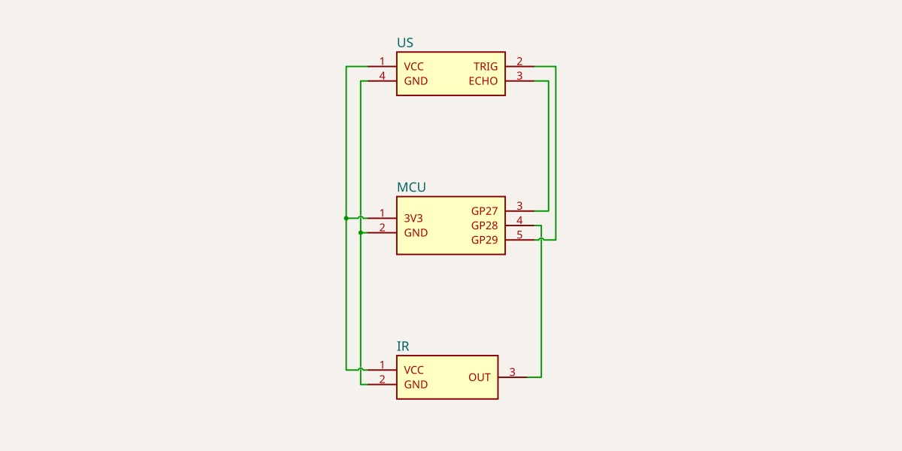

# RP2040 IR + Ultrasonic HID Sketch

One digital IR proximity/obstacle sensor and one HC-SR04-style ultrasonic distance sensor on a Waveshare RP2040-Zero, exposed as a single native USB HID keyboard. The IR sensor reports tap/hold gestures; the ultrasonic sensor turns hand distance into a volume knob.

The firmware only classifies physical gestures and emits otherwise-unused function keys. It never sends shortcuts, media keys or modifiers; host software (Kanata, Karabiner-Elements, ...) decides what each key means.

Forked from `../rp2040-ir-hid/` (the IR-only sketch, `feature/rp2040-ir-hid` branch), which this sketch's IR half is unchanged from.



## Wiring

| Function      | RP2040-Zero pin |
| -------------- | ---------------- |
| IR OUT         | GP28              |
| Ultrasonic TRIG | GP29             |
| Ultrasonic ECHO | GP27             |
| VCC (both)     | 3V3               |
| GND (both)     | GND               |

GP27, GP28 and GP29 are ordinary exposed GPIOs on the RP2040-Zero (on a Raspberry Pi Pico GP29 is wired to VSYS sensing, which is why some docs call it unavailable; that does not apply here).

**Echo voltage**: classic HC-SR04-style breakouts echo back at whatever voltage powers them. Power the ultrasonic module from **3V3, not 5V** — RP2040 GPIOs are 3.3V max, and running ECHO at 5V without a level shifter or divider risks the pin. Most HC-SR04 clones work down to 3.3V with a shorter, slightly less reliable max range, which is an acceptable trade for not needing extra parts. If your module is a genuinely 5V-only part, add a resistor divider on ECHO instead of powering it from 3V3.

The IR pin is configured as plain `INPUT` (the module drives OUT itself through its comparator and on-board pull-up). TRIG is `OUTPUT`; ECHO is `INPUT`.

## HID map

| Gesture    | Key   | Behaviour                                          |
| ----------- | ----- | ---------------------------------------------------- |
| IR hold     | `F15` | held while the sensor is active                     |
| IR tap      | `F16` | single press                                         |
| Volume up   | `F20` | repeated taps while a hand is in the near zone       |
| Volume down | `F21` | repeated taps while a hand is in the far zone        |

IR and volume are independent and each own their own key slot, so an IR tap never interrupts a volume ramp and vice versa (see `inputs.h`'s `syncKeySlot`).

## Timing model

### IR (unchanged from rp2040-ir-hid)

| Setting              | Default | Meaning                                                            |
| ---------------------- | ------- | --------------------------------------------------------------------- |
| `IR_DEBOUNCE_MS`       | 10      | Raw OUT must be stable this long before the sensor state changes     |
| `IR_HOLD_THRESHOLD_MS` | 300     | The sensor must stay active this long to become a hold rather than a tap |
| `IR_REARM_MS`          | 150     | The sensor must stay clear this long after a gesture before the next |
| `IR_TAP_MS`            | 20      | How long the tap key is held down                                    |

See `ir_gesture.h` for the tap/hold state machine.

### Ultrasonic ranging

| Setting            | Default | Meaning                                                              |
| -------------------- | ------- | ------------------------------------------------------------------------ |
| `PING_INTERVAL_MS`   | 60      | How often loop() starts a new trigger pulse                             |
| `MAX_ECHO_US`        | 5000    | How long to wait for an echo before calling the ping "nothing in range" |

Ranging never calls `pulseIn()`: a periodic trigger is scheduled by `millis()`, and the echo pulse width is timestamped by an interrupt on `ULTRASONIC_ECHO_PIN` using `micros()`. A slow or absent echo (nothing in front of the sensor) cannot stall the shared 1kHz HID loop; `MAX_ECHO_US` is scaled to `VOL_MAX_RANGE_CM` rather than the sensor's full ~400cm spec range, so an empty room re-triggers in a few milliseconds instead of the HC-SR04's worst-case ~38ms.

### Volume gesture

| Setting                | Default | Meaning                                                             |
| ------------------------ | ------- | ------------------------------------------------------------------------ |
| `VOL_NEAR_CM`             | 10      | Distance (cm) at which a hand enters the near (volume up) zone          |
| `VOL_NEAR_RELEASE_CM`     | 14      | Distance the hand must exceed to leave the near zone                    |
| `VOL_FAR_CM`              | 25      | Distance at which a hand enters the far (volume down) zone              |
| `VOL_FAR_RELEASE_CM`      | 21      | Distance the hand must fall below to leave the far zone                 |
| `VOL_MAX_RANGE_CM`        | 40      | Readings beyond this (or a missing echo) are "nothing in range"         |
| `VOL_PULSE_INTERVAL_MS`   | 150     | How often a volume key is tapped while a zone holds                     |
| `VOL_PULSE_ON_MS`         | 30      | How long each tap is held down                                          |

- **Zones, not a single threshold**: `VOL_NEAR_RELEASE_CM < VOL_FAR_RELEASE_CM < VOL_FAR_CM` leaves a dead zone between near and far (14-25cm by default) where resting a hand changes nothing.
- **Hysteresis**: entering the near zone needs `distance <= VOL_NEAR_CM`, but leaving it needs `distance > VOL_NEAR_RELEASE_CM`. A hand hovering right at a boundary cannot flicker between zones and the OS volume. Far mirrors this on the other side.
- **Repeat, not hold**: unlike the IR hold key, a volume key is not simply held down. It taps every `VOL_PULSE_INTERVAL_MS` for as long as the hand stays in a zone, the same way turning a rotary encoder emits a steady stream of volume ticks rather than one long keypress.
- **Out of range**: no echo, or a reading beyond `VOL_MAX_RANGE_CM`, is always "no zone" — an empty room in front of the sensor never ramps volume on its own.

The classifier (hysteresis + repeat-tap state machine) is documented at the top of `volume_gesture.h` and has no Arduino dependencies, so it is covered by the host tests below; the ranging/interrupt code is in the `.ino` itself.

## Configuration

All settings live in `config.h` and can be overridden without editing files:

```bash
arduino-cli compile --fqbn rp2040:rp2040:waveshare_rp2040_zero \
  --build-property compiler.cpp.extra_flags="-DVOL_NEAR_CM=8 -DVOL_PULSE_INTERVAL_MS=100" \
  pedals/rp2040-ir-ultrasonic-hid
```

| Setting                                    | Default               |
| --------------------------------------------- | ------------------------ |
| `IR_PIN`                                      | `28`                      |
| `ULTRASONIC_TRIG_PIN` / `ULTRASONIC_ECHO_PIN` | `29` / `27`              |
| `IR_PIN_MODE`                                 | `INPUT`                   |
| `IR_ACTIVE_STATE`                             | `LOW`                      |
| `IR_HOLD_KEY` / `IR_TAP_KEY`                  | `KEY_F15` / `KEY_F16`     |
| `VOL_UP_KEY` / `VOL_DOWN_KEY`                 | `KEY_F20` / `KEY_F21`     |
| `HID_POLL_INTERVAL_MS`                        | `1`                        |
| `USB_MANUFACTURER`                            | `"TLTR"`                   |
| `USB_PRODUCT`                                 | `"TLTR IR Ultrasonic HID"` |
| `DEBUG_SERIAL`                                | `0`                         |

The build fails with a `static_assert` if any two pins collide or fall outside GPIO 0-29, if two events share a key, if a key is `0` or a modifier, if an active state is not `LOW`/`HIGH`, or if the IR/ranging/volume timing values contradict each other (e.g. `VOL_NEAR_CM >= VOL_NEAR_RELEASE_CM`, or zones overlapping).

`DEBUG_SERIAL=1` prints IR and volume state changes over the USB serial port. HID works the same with or without it.

## Sensor tuning

**IR**: see `../rp2040-ir-hid/README.md`'s sensor tuning section; it's unchanged here.

**Ultrasonic**:

1. Build and flash with the defaults.
1. Open a key viewer on the host (see below).
1. Hold a hand about 5-10cm from the sensor: `F20` should tap repeatedly (roughly every 150ms) for as long as the hand stays there.
1. Move the hand to about 20-25cm: `F20` stops, and `F21` starts tapping instead.
1. Rest the hand between the two zones (around 15-20cm), or move it beyond `VOL_MAX_RANGE_CM` (40cm) or out of the sensor's view entirely: nothing taps.
1. If the zones feel too close together or too far from the board for your mounting, adjust `VOL_NEAR_CM`/`VOL_FAR_CM` (and their matching `_RELEASE_CM`, which must stay between the near and far thresholds) at compile time.

## Build

Install `arduino-cli` (`brew install arduino-cli`, or `nix shell nixpkgs#arduino-cli`) and the community-maintained [`arduino-pico`](https://github.com/earlephilhower/arduino-pico) core by Earle F. Philhower, III:

```bash
arduino-cli config add board_manager.additional_urls \
  https://github.com/earlephilhower/arduino-pico/releases/download/global/package_rp2040_index.json
arduino-cli core update-index
arduino-cli core install rp2040:rp2040
```

Build from the repository root, writing the UF2 outside the sketch:

```bash
arduino-cli compile --fqbn rp2040:rp2040:waveshare_rp2040_zero \
  --output-dir /tmp/tltr-ir-ultrasonic-hid pedals/rp2040-ir-ultrasonic-hid
```

This produces `/tmp/tltr-ir-ultrasonic-hid/rp2040-ir-ultrasonic-hid.ino.uf2`. Leave the core's USB stack on the default Pico SDK option; the built-in `Keyboard` library depends on it.

## Flash

1. Put the RP2040-Zero into the ROM bootloader: hold `BOOT` while plugging in USB, or with USB connected hold `BOOT`, press and release `RESET`, then release `BOOT`.
1. A drive named `RPI-RP2` appears.
1. Copy the UF2 onto it:

   ```bash
   cp /tmp/tltr-ir-ultrasonic-hid/rp2040-ir-ultrasonic-hid.ino.uf2 /Volumes/RPI-RP2/
   ```

1. The board reboots and enumerates as `TLTR IR Ultrasonic HID`.

## Verify on macOS

1. Open Karabiner-EventViewer (ships with Karabiner-Elements; allow Input Monitoring if asked). Any other key event viewer works too.
1. Check System Information -> USB lists `TLTR IR Ultrasonic HID`.
1. IR: hold a hand over the IR sensor for about half a second -> `f15` down, then up when you move away. A quick pass -> a brief `f16`.
1. Volume up: hold a hand 5-10cm from the ultrasonic sensor -> repeated `f20` taps.
1. Volume down: move the hand to 20-25cm -> repeated `f21` taps instead.
1. Dead zone: rest the hand between the two distances, or move it away entirely -> nothing taps.
1. Concurrency: hold the IR sensor and the volume gesture at once -> `f15`/`f16` and `f20`/`f21` are independent; neither interrupts the other.
1. Put the Mac to sleep and wake it, or unplug and replug, while holding a gesture: no key stays stuck.

macOS may ask to identify the new keyboard with the Keyboard Setup Assistant; it can be closed.

## Host tests

The gesture logic in `ir_gesture.h`, `volume_gesture.h` and `inputs.h` has no Arduino dependencies. `../tests/run.sh` builds `../tests/gesture_tests.cpp` with the host compiler and replays IR and volume scenarios (holds, taps, zone hysteresis, out-of-range, re-arm, wraparound) against it. The ranging/interrupt code in the `.ino` itself is not host-testable and is instead covered by compiling the sketch with `arduino-cli`.

## Circuit diagram

`circuit/index.circuit.tsx` is a [tscircuit](https://tscircuit.com) schematic of the wiring above (`MCU`/`IR`/`US` are generic footprints standing in for the real parts, not a fabricatable board). Regenerate `circuit/wiring.schematic.svg` after editing it:

```bash
cd pedals/rp2040-ir-ultrasonic-hid/circuit
npm install   # or bun install
npx tsci export index.circuit.tsx -f schematic-svg -o wiring.schematic.svg   # or bunx tsci ...
```

`npm install`/`bun install` first is required: `npx tsci`/`bunx tsci` without a local install resolves to an unrelated npm package also named `tsci` (a 2023 tool, not tscircuit's CLI) instead of fetching `@tscircuit/cli`.
